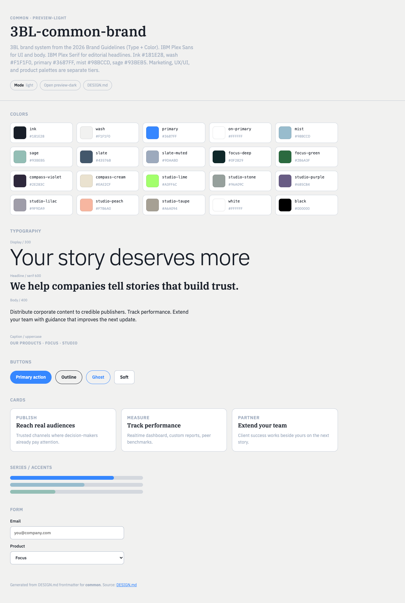
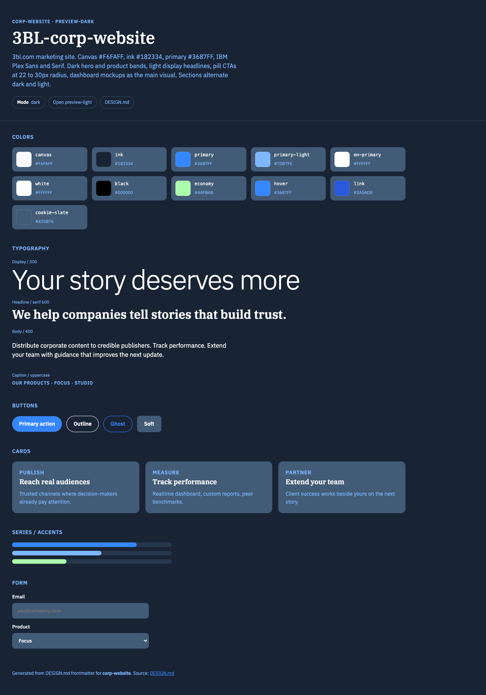
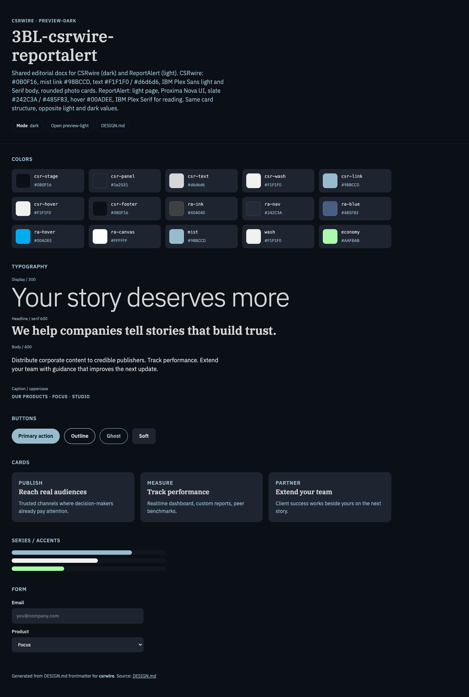

# 3BL DESIGN.md

Stitch-format DESIGN.md files for 3BL products. Folder layout matches [VoltAgent/awesome-design-md](https://github.com/VoltAgent/awesome-design-md): one product per folder under `design-md/`. Spec: [Stitch DESIGN.md](https://stitch.withgoogle.com/docs/design-md/overview/).

Load a product `DESIGN.md`, and `common` when the work is brand-owned marketing or editorial.

## Collection

| Product | DESIGN.md | Previews | Screenshots |
|---------|-----------|----------|-------------|
| Common brand | [common](design-md/common/DESIGN.md) | [light](design-md/common/preview-light.html) · [dark](design-md/common/preview-dark.html) | [preview-light.png](design-md/common/preview-light.png) |
| Corp website | [corp-website](design-md/corp-website/DESIGN.md) | [light](design-md/corp-website/preview-light.html) · [dark](design-md/corp-website/preview-dark.html) | [3bl.com](design-md/corp-website/screenshot.png) |
| Client portal | [client-portal](design-md/client-portal/DESIGN.md) | [light](design-md/client-portal/preview-light.html) · [dark](design-md/client-portal/preview-dark.html) | [Gin preview](design-md/client-portal/screenshot.png) |
| Visualizations | [visualizations](design-md/visualizations/DESIGN.md) | [light](design-md/visualizations/preview-light.html) · [dark](design-md/visualizations/preview-dark.html) | [dark preview](design-md/visualizations/screenshot.png) |
| 3BL Media | [3blmedia](design-md/3blmedia/DESIGN.md) | [light](design-md/3blmedia/preview-light.html) · [dark](design-md/3blmedia/preview-dark.html) | [3blmedia.com](design-md/3blmedia/screenshot.png) |
| CSRwire / ReportAlert | [csrwire](design-md/csrwire/DESIGN.md) | [light](design-md/csrwire/preview-light.html) · [dark](design-md/csrwire/preview-dark.html) | [CSRwire](design-md/csrwire/screenshot-csrwire.png) · [ReportAlert](design-md/csrwire/screenshot-reportalert.png) |

### Preview galleries

Open the HTML files for the interactive catalog. PNGs below are full-page captures of those catalogs.

**Common** · [light](design-md/common/preview-light.png) · [dark](design-md/common/preview-dark.png)

**Corp website** · [light](design-md/corp-website/preview-light.png) · [dark](design-md/corp-website/preview-dark.png) · [live 3bl.com](design-md/corp-website/screenshot.png)

**Client portal** · [light](design-md/client-portal/preview-light.png) · [dark](design-md/client-portal/preview-dark.png)

**Visualizations** · [light](design-md/visualizations/preview-light.png) · [dark](design-md/visualizations/preview-dark.png)

**3BL Media** · [light](design-md/3blmedia/preview-light.png) · [dark](design-md/3blmedia/preview-dark.png) · [live](design-md/3blmedia/screenshot.png)

**CSRwire / ReportAlert** · [light](design-md/csrwire/preview-light.png) · [dark](design-md/csrwire/preview-dark.png) · [live CSRwire](design-md/csrwire/screenshot-csrwire.png) · [live ReportAlert](design-md/csrwire/screenshot-reportalert.png)





## How to use

1. Open the product folder's `DESIGN.md`.
2. For brand-owned marketing or editorial work, also load `design-md/common/DESIGN.md`.
3. Name the surface in the prompt, for example "3bl.com hero", "Gin portal form", or "Focus dashboard card".
4. Open `preview-light.html` or `preview-dark.html` in a browser to check tokens, type, and components.

## Regenerate previews

```bash
python3 scripts/generate_previews.py
```

That rebuilds `preview-light.html` and `preview-dark.html` from each `DESIGN.md` frontmatter.

Live site and preview PNG screenshots were captured with `agent-browser` (`screenshot --full`). Re-run those captures after major token or site changes.

## Notes

- Filename is `DESIGN.md` (Stitch / VoltAgent convention).
- ReportAlert URL is reportalert.com (singular).
- Client portal docs describe stock Gin, not a private theme scrape.
- CSRwire light preview maps to ReportAlert tokens. CSRwire dark preview maps to CSRwire tokens.
